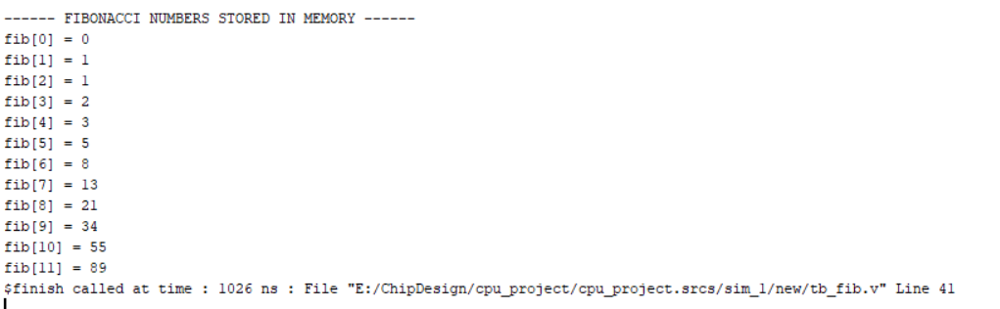

# Single-Cycle RISC-V (RV32I) CPU in Verilog

A simple 32-bit RISC-V CPU written in Verilog and tested in Xilinx Vivado.
It runs programs written in RISC-V assembly, including a Fibonacci program.

## What's inside
- rtl/ : CPU design files (ALU, registers, control unit, memories)
- tb/ : testbenches
- sw/ : assembly programs and a Python assembler

## How it works
Each clock tick the CPU fetches an instruction, decodes it, runs it in the ALU,
reads or writes memory if needed, and saves the result in a register.

## Results
- Testbench: all checks passed
- Fibonacci program: prints 0, 1, 1, 2, 3, 5, 8, 13, 21, 34, 55, 89

